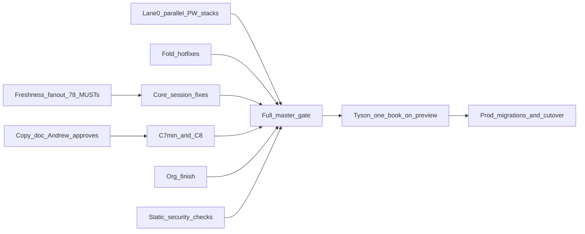

Approved by Andrew 2026-11-17; executing.

# Launch to pilot: finish line plan

## Where we are (2026-11-17)

- **Production is behind.** [usemynk.com](https://usemynk.com) serves `master` at `97c42ae8` (Sep 30). Git `master` is `eebafee1`, and its production deploy was canceled.
- **Everything since Oct 6 is on one branch.** `feat/org-qol` (`71e2bc14`) is 419 commits ahead of master, with a READY preview. It holds org, the consent wave through C6, QoL fixes, and the Cloudflare TURN code.
- **TURN keys are already set.** Both keys exist in Vercel for production and preview, and Twilio env is set for production.
- **Hotfixes are not merged and neither has a passed hardware smoke.**
  - `fix/wb-student-apply-race` adds 9 commits. Its unique part is the student edit kept during a tutor apply; its TURN code is identical to `feat/org-qol`.
  - `fix/transcript-silence-hallucination` adds 5 commits: silence drop and an English-only notice.
- **Org works once the operator creates it.** Missing: org self-serve, a timezone choice (Denver only), W7 polish, the failing in-person Open room test, and org oversight of notes (a deliberate cut).
- **Consent wave has C7 (UI copy) and C8 (privacy/terms) left.** The privacy page is now untrue in two places: it says the board is always kept and every recording is transcribed. So C8 is required before release. Seven migrations need Andrew's go for production.
- **Backlog is stale.** It has 78 "MUST" rows, many from July and since fixed.
- **Tyson books are stale.**
  - The live packet scored 65 pass, 3 partial, 1 fail, against `af876496`/`c2e97afb`.
  - Only these are truly human: a two-device drawing and video session, real SMS, and Apple Calendar.
- **No payments.** No pen test. A static-check pipeline exists on `sec/audit-pipeline`, which is not merged.
- **Stale worktrees:** `../tn-org` and `../tn-qol-hydrate`, both fully merged.

## Andrew decisions (2026-11-17)

- One release: fold both hotfixes into `feat/org-qol` and ship that.
- Curated pilot: keep tutor approval and get an email on every signup.
- Free pilot now. Stripe and a pricing page come during the pilot.
- Security before pilot means industry-standard static checks. The AI pen test happens before pilot only if it can be isolated cleanly in about a day; otherwise it runs during the pilot. The human pen test waits for income.
- Legacy audio-only replay is accepted (old sessions are almost all test data).

## Testing policy change (needs recording as Andrew's waiver)

- **Core flow keeps full red-before/green-after Playwright.** Core flow means: whiteboard, live A/V, session entry and consent, recording, End, notes, and replay.
- **Everything else gets one happy-path test plus one failure-path test, and a quick independent review.** No exhaustive matrix.
- Record this as Andrew's dated waiver in `docs/BACKLOG.md` and in the scope line of `.cursor/rules/exhaustive-testing-mandate.mdc`, so agents don't refuse it.

## Staffing

- **Grok** (`grok-4.7-high`) does hands work by default: reading, code, tests, docs, triage, and gate runs.
- **`composer-2.5`** handles pure mechanical docs and file moves.
- **Sonnet** (`claude-sonnet-5-5-high`) does two things:
  - Executes on fragile surfaces: the WB apply path, live A/V, the End and recording path.
  - Reviews core-flow changes, readonly.
- **Opus** steps in only after Sonnet fails twice on the same thing. Never `composer-2.5-fast`.
- **Parallelism:**
  - Code lanes run concurrently in isolated worktrees.
  - Playwright is limited by shared runtime (port 3100, relay 3002, DB `tutoring_notes_test`), so Lane 0 makes those configurable so 2–3 stacks can run at once.
  - Until Lane 0 lands, Playwright runs one at a time through a queue.

## Bucket A: must ship before people use it (target 6–8 working days)

**A0. State and hygiene (Grok/composer, day 1, parallel)**

- Write `docs/handoff/LAUNCH-STATE.md`: the facts above plus links. Restructure `docs/handoff/ORCHESTRATOR-STATE.md` around this plan.
- Rewrite the top of `docs/BACKLOG.md` into Buckets A, B, and C. Each MUST row gets a bucket after the freshness pass (A4).
- Record the testing-policy waiver.
- Remove the `../tn-org` and `../tn-qol-hydrate` worktrees. Check first: no uncommitted work, nothing unpushed, and no `node_modules` junction.

**A1. Lane 0: parallel Playwright stacks (Grok)**

- Make the dev port, relay port, and test DB name configurable through env in `playwright.config.ts` and `scripts/wb-regression-local-db.cjs`.
- Each worktree runs its own stack.
- Done when two `wb-regression` tag runs pass at the same time from two worktrees.

**A2. Fold the hotfixes into `feat/org-qol`**

- **Transcript hotfix (Grok):** cherry-pick `3cf88434`, `54ef13b8`, `40b85367`, `7632285d`, resolving conflicts in the notes worker and the waiting room. This closes gap G6: a silent or cliché chunk is dropped, and the whisper-1 text is not stored.
- **Apply-race student edit (Sonnet, fragile WB sync):** port `b825b828`, `23c2bfa7`, `eae40956`, `0570a200`, `13d64d50`. Skip the TURN commits, which are already present.
  - Conflicts are expected in `apply-reconciled-remote-scene.ts`, `useStudentWhiteboardCanvas.ts`, and `WhiteboardWorkspaceClient.tsx`.
  - Gate: `wb-student-apply-race.spec.ts` plus `@wb-sync`.
  - Separate Sonnet review.

**A3. Consent finish (C7-min + C8)**

- **Copy doc (Grok):** draft one document listing every user-visible consent string from plan section 7. Andrew approves it in one pass. This is the only Andrew blocker in Bucket A besides the cutover go.
- **C8 (Grok, after approval):** make privacy and terms honest.
  - Board deleted at End when whiteboard recording is off.
  - No transcript or drafted notes when notes are off.
  - Replay follows what was recorded.
  - Never claim the reaper ends sessions while it is in dry_run.
  - Follow the `docs/LEGAL-SYNC.md` dates.
  - Test: `legal-honesty.spec.ts`.
- **C7-min (Grok, Sonnet review):** the strings a user must see to understand a blocked or missing thing.
  - Waiting-room reason, the `/join` reason, review empty states (board not saved vs nothing drawn), the next-session sentence, and the online_off eviction line.
  - Tests: V1–V4, E-copy, S2b, M16b.
  - Deduplicating the forked copy moves to Bucket B. It is existing debt, not new duplication.
- **C9 trimmed:** clear the remaining `.fixme` rows that are real (S9a, S10a, S12). Move W26 to Bucket B with a backlog entry.

**A4. Freshness fan-out, then fix core-session bugs**

- **Fan-out (6 Grok explore agents in parallel):** each verifies about 13 of the 78 MUST rows against current code and tests.
  - Each row comes back as fixed (with evidence), open (with a repro test name), or obsolete.
  - Priority rows: `W1-SHIP-B-FINALIZE`, `SMOKE-AUDIO-1`, `SMOKE-NOTES-1`, `SMOKE-UX-1`, `WS-B`, `SMOKE-BLOCK-1`, `BUG-8`, phone student A/V, `B11`, `WS-T-8`, `WS-T-9`, student "Loading scene", images on the student board, `LIVE-SESSION-START-AFFORDANCE`, `Self-learner claim PIN`, `Claim verify-email SameSite`.
- **Fixes:** every confirmed-open item in the core session flow is fixed with red/green Playwright.
  - Sonnet on fragile surfaces (recorder, End, A/V); Grok elsewhere.
  - One lane per item, parallel where the files don't overlap.
- **G1 camera tile after a waiting-room reload (Tyson item 35):** A/V is fragile, so it gets a plan pass first, then Sonnet. The test goes in `wb-av-mesh.spec.ts`.

**A5. First-impression fixes (Grok, light tests)**

- **Public limits page:** `/limits`, built on a refreshed `known-issues-roadmap-content.ts`. It covers English-only notes, approval, and claim plus consent before Start. Link it from home and from signup.
- **Clear Start reason:** Start on student detail and in the waiting room reads "waiting for the parent to accept the invite / save privacy". Use the existing `SessionEntryBlocked` copy; verify it, don't rebuild it.
- **Signup notice:** confirm every signup emails `ADMIN_EMAIL` (`OPERATOR_EMAILS` is unset in Vercel) and that the approval link works.
- **Email 2FA:** offer it only when mail can send (`BL-2FA-EMAIL-AVAIL`). This is S, and it protects new tutors.

**A6. Org functionality for school pilots**

- **Timezone (Grok):** the operator create form takes a timezone and stores `Organization.timezone`. Test: week labels follow it.
- **W7 (Grok):** appointment row labels, no instructor picked by default when booking, and a confirm before removing a member.
- **Fix `wb-org-booking.spec.ts:587` (in-person Open room when online is off) and `:239` (Grok triage, Sonnet if it reaches session entry).**
- **Instructor Account & sharing 404:** decide during the triage. It goes into Bucket A only if a school instructor needs it in the first session; otherwise Bucket B.
- **Operator runbook (composer):** `docs/handoff/ORG-SETUP-RUNBOOK.md` covers creating an org for a school, activating it, inviting the owner, and the owner's first steps.

**A7. Static security gate (Grok)**

- Port the check commits from `sec/audit-pipeline`: Semgrep (OWASP/TS/React/Next), gitleaks, `npm audit` for high/critical, and `src/__tests__/security`. Run them on `feat/org-qol`.
- Fix high and critical findings. Medium findings go to Bucket B.
- Take dependency upgrades only when needed to clear a high or critical advisory, and test each one (nodemailer, pdfjs).
- **AI pen test, timeboxed to one day (Grok spike):** a quarantined local target (`next start` against the local test DB and blob harness, no shared services; the sec branch already has a "local only" preflight).
  - If an isolated run works within the timebox, run it before the pilot.
  - Otherwise it moves to Bucket B.

**A8. Release gate (Grok runs, conductor judges)**

- Full gate on the integrated tip: `test:wb-sync` + `test:regression` + `test:prod-shape` + `next build`.
- Fix the known reds, or update stale tests when the behavior is intended (stage6 `:605`).
- Anything we'd quarantine needs Andrew's explicit waiver, asked at that point.

**A9. One accurate Tyson book (Grok, template-compliant)**

- **Preview:** `docs/handoff/PILOT-RELEASE-SMOKE.md`, with the preview URL fetched from Vercel. Point preview.usemynk.com at `feat/org-qol` only with Andrew's go (it is a Vercel write).
- **Human-only items:**
  - Two-device session with a phone student: join, video and audio both ways on different networks (TURN), drawing while the tutor switches boards, End, notes, replay.
  - Camera tile after a reload.
  - Transcript English-only notice, and that the notes feel trustworthy.
  - Signup through approval to first student, as a stranger.
  - School walkthrough as owner, instructor, and family.
  - Light and dark themes for the pre-master pass.
- **Coverage:** every other item cites its Playwright test in Coverage and is not repeated.
- **Not Tyson:** SMS 2FA (only after the A2P campaign is approved) and Apple Calendar (Andrew or Sarah).
- **Drive cleanup:** move stale Drive docs to the archive folder after Andrew's go (a Drive write).

**A10. Cutover (Andrew go required)**

- Apply the seven migrations to a Neon branch copy of production first, smoke it, then apply to production.
- Leave `CONSENT_REAPER_MODE` unset (dry_run). The new cron runs `session-cleanup`.
- Notify Sarah. Check CUT-4: Sarah's pilot family is claimed before the notes wall bites.
- `merge --no-ff feat/org-qol` into master, push, verify the production deploy is READY, run a post-deploy smoke of the core flow on production.

## Bucket B: during the pilot

- Stripe checkout and a pricing page. AI pen test, if not done in A7. Medium security findings.
- C7-rest: deduplicate forked consent copy. W26. Remaining consent jest todos.
- Org:
  - Instructor Account & sharing.
  - W5 merged roster row.
  - W6 last org stored per account.
  - Learner and claim caps on the operator form.
  - W9 replay-missing reason.
  - Org oversight of notes, if schools ask.
- Turn the reaper to `enforce` after Andrew reads the `would_reap` logs.
- SMS A2P campaign, then H2.
- Observability:
  - Error tracking (new CSP origin plus a `PLATFORM-ASSUMPTIONS` entry).
  - An operator funnel page from `ProductEvent` (signup to approved to 2FA to first student to first ended session to note saved).
- Remaining MUST rows the freshness pass marked open but not first-session: recording resilience (WS-B and pagehide if not in A), notes accuracy (SMOKE-NOTES-3, map/reduce eval), student-detail declutter, G4 tutor graph delete, `SEC-TUTOR-ADD-CAP`, `SEC-ROSTER-HANDLE-ENUM`, `WB-SESSION-MAX-DURATION`.
- TXC-LANG Spanish, when the first Spanish tutor or family appears.
- **Calculus graphs: conditional.** This moves up to Bucket A as soon as a college or university org that needs calculus is in the pipeline (Andrew 2026-11-17).
  - What's built today: algebra, log, and trig plotting.
  - Prep now, cheap and harmless: a Grok explore pass that sizes calculus support (derivatives, integrals, limits, and how the graph embed evaluates them), so the work is pre-scoped when a college asks.

## Bucket C: after the site is live

- Human pen test, once there is income.
- Self-serve org signup. Org billing and departments. Two-way calendar sync. Apple CalDAV.
- Wyzant/UVU export. Brand pass. (Calculus moved to Bucket B as conditional.)
- Dedupe waves C/D. The rest of MAYBE (254) and 1.x (145).

## Rules that still hold

- Server actions assert ownership. Migrations are additive. No production DB or Vercel/Drive writes without Andrew's go.
- Never print secrets.
- Whiteboard chrome changes are additive only.
- Subagents never merge, pull, restore, or reset to get unblocked.
- Commit through `.git/COMMIT_MSG_DRAFT.txt` and push `origin feat/org-qol`.
